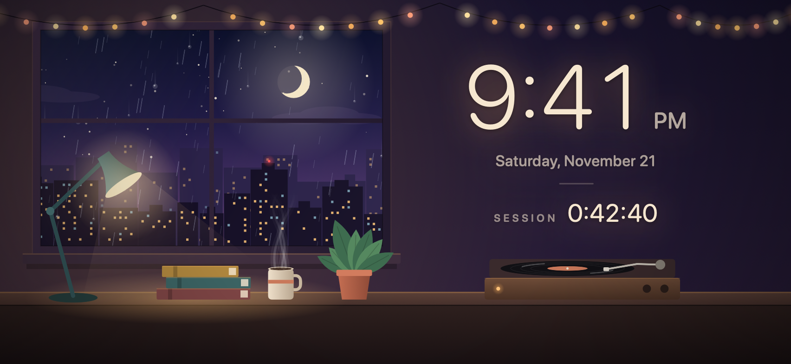
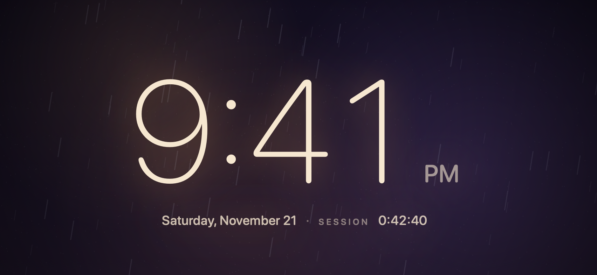
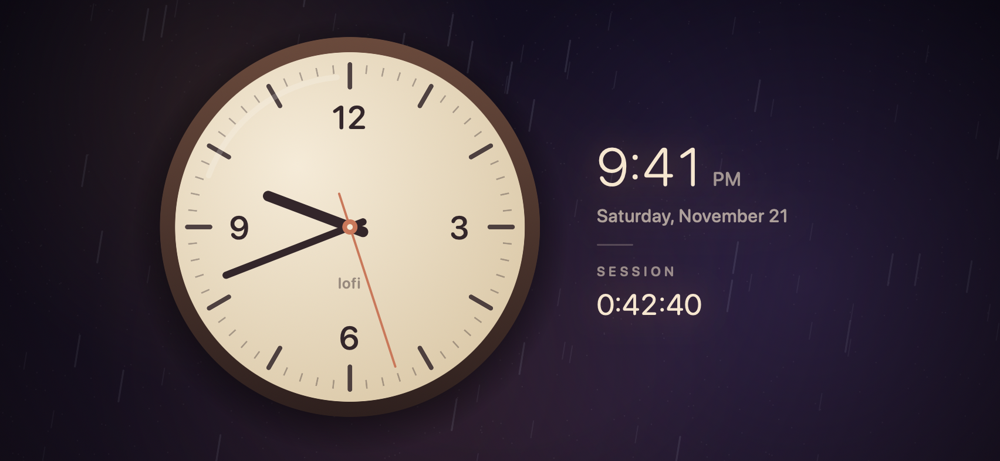
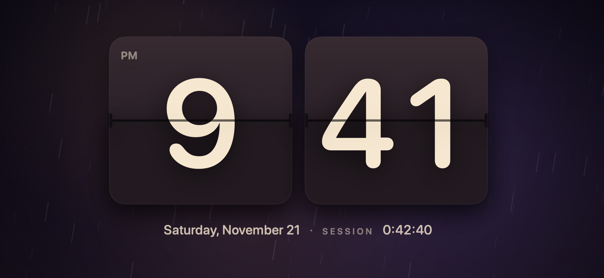
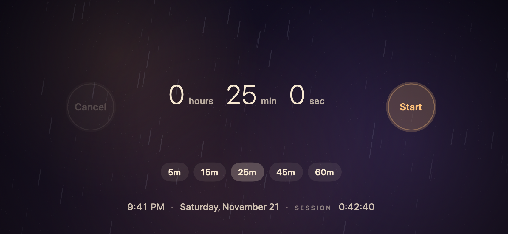
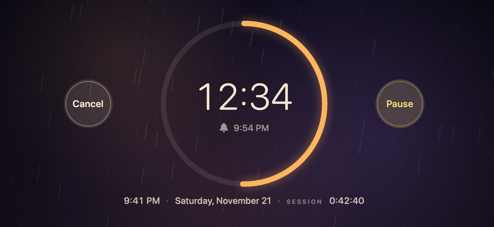
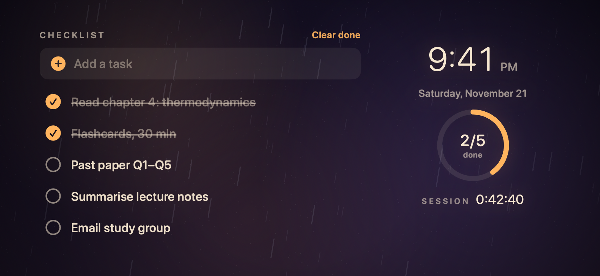
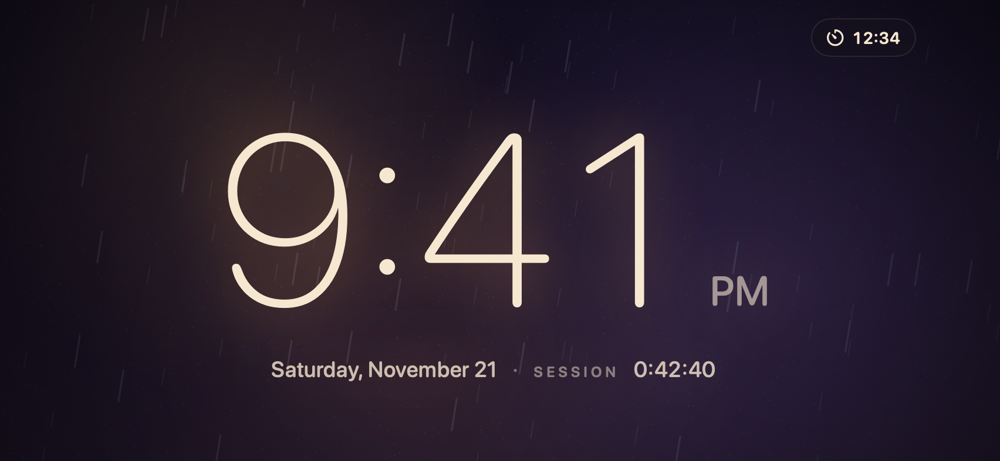
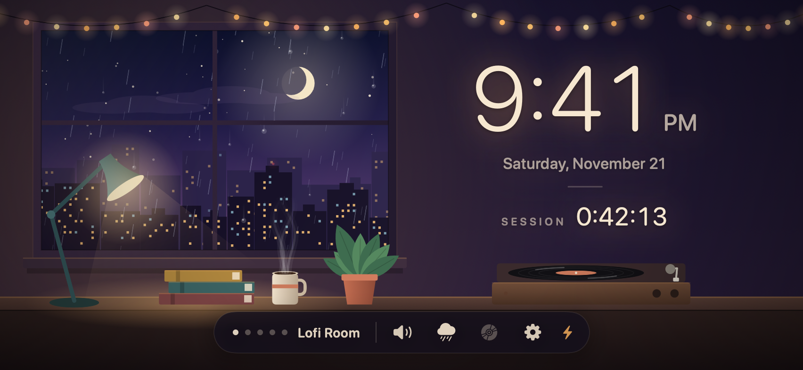
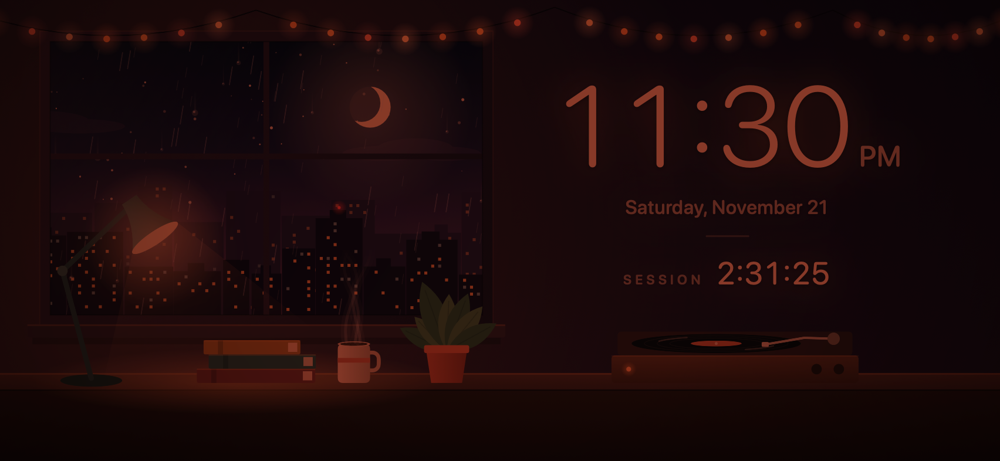

# Lofi Dock

An always-on lofi desk clock for iPhone. iPhones without an always-on display
(every model except the recent Pros) turn StandBy's screen off after a few
seconds. Lofi Dock keeps the screen on for as long as it's open, whatever
Auto-Lock is set to, in landscape, with a lofi look and a session timer that
restarts each time you leave the app.

## Faces

Swipe left or right to change face; the choice is remembered.

| Lofi Room | Big Digits |
|---|---|
|  |  |
| **Analog** | **Flip** |
|  |  |
| **Timer** (set) | **Timer** (running) |
|  |  |
| **Checklist** | |
|  | |

The clock-only faces sit on a dim backdrop of drifting haze, faint rain and
film grain.

### Timer

Laid out like the iPhone Clock timer: hour/min/sec wheels (the Mac preview
above shows a readout instead) plus 5/15/25/45/60-minute presets, Cancel on
the left, Start/Pause/Resume on the right, and a ring that empties while it
runs, with the end time under the countdown. At zero the ring blinks, a soft
chime repeats for up to a minute and the phone vibrates; tap Stop. On the
other faces a chip in the corner shows the time left (tap it to jump to the
timer, or to stop it once it rings). If you leave the app, a notification
announces the end; the first Start asks for notification permission.

### Checklist

Type into **Add a task** at the top (it sits there so the landscape keyboard
doesn't cover it; the keyboard stays up for the next task, and Done on an
empty field puts it away). Tap a task to tick it off; touch and hold to
delete it; **Clear done** removes everything ticked. The time, date, session
and a done/total ring sit beside the list. Unlike the session timer, the list
is kept between launches.

## Controls and settings

Tap anywhere to bring up the control bar (it hides itself after 5 s): face
dots (tap to go to the next face), mute, rain, vinyl crackle, settings, and a
bolt while charging. While muted, tapping rain or
vinyl unmutes and plays that sound.

Settings, each with its own switch:

- **Keep screen on → Only while charging** (default off): by default the
  screen never turns off while Lofi Dock is in front, whatever Auto-Lock is
  set to in the phone's Settings. Turn this on to keep it on only while
  charging and let Auto-Lock apply off the charger.
- **Mute all sound** (default off): silences rain, vinyl and the timer chime,
  keeping the rain/vinyl choices for later. A finished timer still blinks and
  vibrates.
- **Rain on the window** (default on): the falling-rain animation on every
  face; separate from the rain sound.
- **Night dimming** (default on, 10 PM–7 AM, adjustable): warms everything to
  deep amber-red and darkens it, so the clock doesn't light up a dark room.
- **Burn-in protection** (default on): shifts the picture a few pixels each
  minute. Matters on OLED iPhones like the iPhone 15; harmless on LCD models.
- **Ease off when warm** (default on): slows the background animation when
  the phone heats up on the charger or is in Low Power Mode. The clock keeps
  exact time regardless.
- **Rain** and **Vinyl crackle**: synthesised live, no audio files. They play
  even with the silent switch on and mix under music from other apps.

Behaviour that isn't a setting:

- While the screen is held on, only you can turn it off (side button, or
  leaving the app). iOS still turns it off if the battery runs out or the
  phone overheats, and a phone call's proximity sensor still darkens it.
- The session timer restarts when the app goes to the background (home
  gesture, app switcher, lock button), not for Control Center or notifications.

### Open automatically on the charger

iOS doesn't let apps replace StandBy, but Shortcuts can launch the app every
time the phone is charged: **Shortcuts → Automation → New → Charger → Is
Connected → Run Immediately**, action **Open App → Lofi Dock**.

## Requirements

- Xcode 26 or later (Command Line Tools alone cannot build iOS apps)
- iOS 17+ iPhone; laid out for iPhone 15 landscape and scales to others
- [XcodeGen](https://github.com/yonaskolb/XcodeGen) (`brew install xcodegen`)

## Run on a phone over Wi-Fi

1. In Xcode, sign in under **Settings → Accounts** (a free Apple ID works;
   free-account installs expire after 7 days, so redeploy weekly).
2. On the iPhone: **Settings → Privacy & Security → Developer Mode** on, and
   join the same Wi-Fi as the Mac.
3. Pair once: Xcode **Window → Devices and Simulators**, select the phone,
   tick **Connect via network**.
4. Pick your team once: open the project in Xcode, target **LofiDock** →
   **Signing & Capabilities** → **Team**, then copy the ID into
   `DEVELOPMENT_TEAM` in `project.yml` (already set on this machine).
5. `scripts/deploy.sh` (looks for a device named `vPhone`; override with
   `DEVICE_NAME=...`). It finds Xcode via `xcode-select`, or at
   `External/Applications/IDE's/Xcode*.app`, or `XCODE_APP=...`.
6. First launch with a free account: on the phone, **Settings → General → VPN &
   Device Management** → trust the developer certificate.

## Disk space on this Mac

The internal disk is small, so everything Xcode writes per user lives on the
external drive. `External/Applications/IDE's/Xcode/move-xcode-data-to-external.sh`
moved Xcode's iPhone symbol files (`iOS DeviceSupport`, 5.2 GB after pairing
one phone), device logs, DerivedData, Archives and caches into
`IDE's/Xcode/files` and left symlinks at the original paths. With the
external drive unplugged, Xcode recreates those folders internally; re-run
the script afterwards. Build outputs from `scripts/deploy.sh` and
`tools/check-mac.sh` go to this project's `build/` folder.

## Develop

- `xcodegen generate` then open `LofiDock.xcodeproj`. Tests: ⌘U.
- Without Xcode: `tools/check-mac.sh [out-dir]` compiles the shared sources for
  macOS, runs the Swift Testing suite, renders every face (plus night, timer,
  muted and controls variants) to PNG, writes rain/vinyl/chime WAVs, times a
  scene frame, and regenerates the app icon from the scene code. Output goes
  to `build/mac-check` by default.
